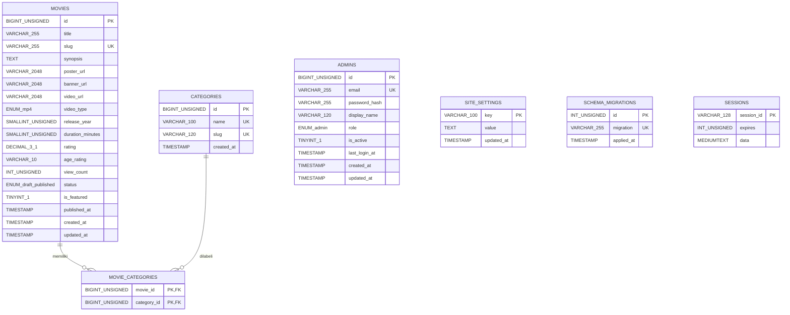
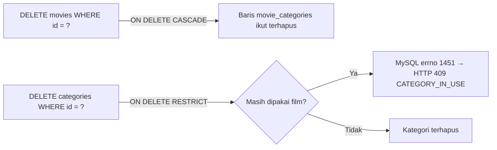

# ERD (Entity Relationship Diagram) — StreamFlix

Entity Relationship Diagram berikut dibuat dengan **Mermaid** dan **sesuai persis** dengan
skema di `database/migrations/` serta `database/schema.sql`.

- **DBMS**: MySQL 8.x, engine InnoDB, charset `utf8mb4`, collation `utf8mb4_unicode_ci`.
- Tipe ditulis tanpa spasi (mis. `BIGINT_UNSIGNED`) karena keterbatasan parser Mermaid;
  padanannya dijelaskan pada catatan di bawah diagram.

## 1. Diagram ERD

> **Catatan tipe**: `BIGINT_UNSIGNED` = `BIGINT UNSIGNED`, `ENUM_draft_published` =
> `ENUM('draft','published')`, `ENUM_admin` = `ENUM('admin')`, `ENUM_mp4` = `ENUM('mp4')`,
> `DECIMAL_3_1` = `DECIMAL(3,1)`, `TINYINT_1` = `TINYINT(1)`. Semua kolom `TIMESTAMP`
> yang bertanda `created_at`/`updated_at` memakai default `CURRENT_TIMESTAMP`
> (dan `ON UPDATE CURRENT_TIMESTAMP` untuk `updated_at`).

## 2. Relasi

| Relasi | Kardinalitas | Keterangan |
|---|---|---|
| `movies` — `movie_categories` | 1 ke 0..N | Satu film memiliki banyak baris relasi kategori; menghapus film **CASCADE** menghapus relasinya |
| `categories` — `movie_categories` | 1 ke 0..N | Satu kategori dipakai banyak film; menghapus kategori yang masih terpakai **RESTRICT** (409) |

**Kardinalitas efektif:** `movies` (N) ↔ (`movie_categories`) ↔ (M) `categories` —
relasi **banyak-ke-banyak**.

### Entitas tanpa relasi FK

- **`admins`** — berdiri sendiri (standalone). Dipakai murni untuk autentikasi dashboard.
  Tidak berelasi dengan film/kategori.
- **`sessions`** — berdiri sendiri. Menyimpan sesi login admin (via `express-mysql-session`).
  Referensi ke admin disimpan di dalam payload sesi, bukan lewat FK database.
- **`site_settings`** — berdiri sendiri, berbentuk key-value.
- **`schema_migrations`** — berdiri sendiri, hanya mencatat migrasi yang telah dijalankan.

## 3. Detail Constraint Penting

| Tabel | Constraint | Nama |
|---|---|---|
| `admins` | UNIQUE(`email`) | `uq_admins_email` |
| `categories` | UNIQUE(`name`) | `uq_categories_name` |
| `categories` | UNIQUE(`slug`) | `uq_categories_slug` |
| `movies` | UNIQUE(`slug`) | `uq_movies_slug` |
| `movie_categories` | PRIMARY KEY(`movie_id`, `category_id`) | (komposit) |
| `movie_categories` | FOREIGN KEY(`movie_id`) → `movies(id)` ON DELETE CASCADE | `fk_mc_movie` |
| `movie_categories` | FOREIGN KEY(`category_id`) → `categories(id)` ON DELETE RESTRICT | `fk_mc_category` |
| `schema_migrations` | UNIQUE(`migration`) | `uq_schema_migrations_migration` |

## 4. Alur Referensial (Referential Actions)

Dokumen terkait: [`DATABASE.md`](./DATABASE.md) · [`ARCHITECTURE.md`](./ARCHITECTURE.md).
