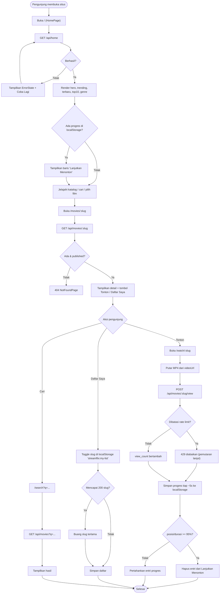
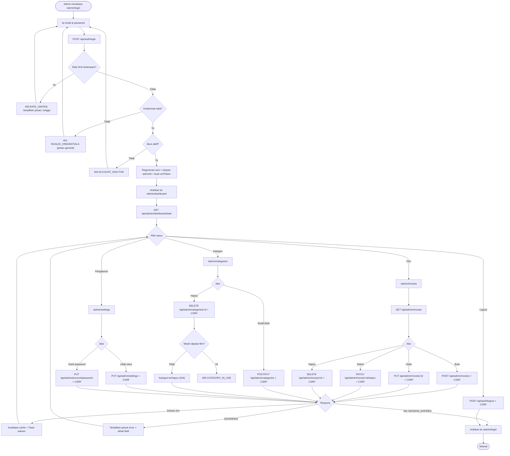
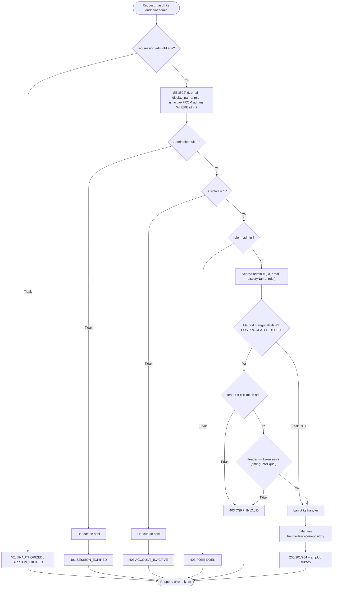

# Flowchart — StreamFlix

Dokumen ini memuat tiga diagram alur (Mermaid flowchart):

1. **Alur Pengunjung** — dari membuka situs hingga menonton dan menyimpan progres.
2. **Alur Admin** — dari login hingga mengelola konten.
3. **Akses Admin tanpa Sesi** — logika keputusan backend saat request admin masuk
   (sesi valid? admin aktif? role admin? method mengubah data? CSRF valid?).

---

## 1. Alur Pengunjung (Visitor Flow)

### Catatan alur pengunjung

- **Tanpa login.** Tidak ada langkah autentikasi bagi pengunjung.
- **Daftar Saya** disimpan pada kunci `streamflix:my-list` (array slug, maks 200, divalidasi Zod).
- **Progres** disimpan pada kunci `streamflix:watch-progress` (map slug → `{positionSec, durationSec, updatedAt}`),
  disimpan setiap ±5 detik; entri dihapus bila mencapai ambang **≥ 95%**.
- Kegagalan `POST /view` (mis. 429) **tidak** menghentikan pemutaran video.

---

## 2. Alur Admin (Admin Flow)

### Catatan alur admin

- Setiap request yang **mengubah data** (POST/PUT/PATCH/DELETE) menyertakan header
  `x-csrf-token`. Bila belum ada, klien mengambilnya dari `GET /api/auth/csrf-token`.
- `401 SESSION_EXPIRED` selalu mengarahkan admin kembali ke `/admin/login`.
- Menghapus kategori yang masih dipakai film menghasilkan `409 CATEGORY_IN_USE`.

---

## 3. Akses Admin tanpa Sesi — Logika Keputusan Middleware

Diagram ini menggambarkan logika sebenarnya di backend saat sebuah request menuju endpoint admin
(`requireAdmin()` lalu `csrfProtect()`), sesuai `backend/src/middlewares/require-admin.ts`
dan `backend/src/middlewares/csrf.ts`.

### Rangkuman keputusan

| Urutan | Pertanyaan | Jika gagal | Status & kode |
|---|---|---|---|
| 1 | Sesi memiliki `adminId`? | Sesi tidak ada / kedaluwarsa | `401 SESSION_EXPIRED` |
| 2 | Admin ditemukan di database? | Tidak ada (sesi usang) | `401 SESSION_EXPIRED` (sesi dihancurkan) |
| 3 | `is_active = 1`? | Akun dinonaktifkan | `403 ACCOUNT_INACTIVE` (sesi dihancurkan) |
| 4 | `role = 'admin'`? | Peran bukan admin | `403 FORBIDDEN` |
| 5 | Method mengubah data? | Jika tidak (GET) → langsung lanjut | — |
| 6 | Header `x-csrf-token` cocok dengan token sesi? | Tidak ada / tidak cocok | `403 CSRF_INVALID` |
| 7 | Semua lolos | — | Lanjut ke handler |

> Catatan implementasi:
> - Pemeriksaan sesi, status aktif, dan peran **selalu di backend** (bukan hanya di frontend).
> - Perbandingan token CSRF memakai `crypto.timingSafeEqual`.
> - Bila admin sudah tidak ada / nonaktif, sesi dihancurkan agar klien tidak terus mencoba.

Dokumen terkait: [`USE-CASES.md`](./USE-CASES.md) · [`API.md`](./API.md) ·
[`ERROR-MAP.md`](./ERROR-MAP.md).
