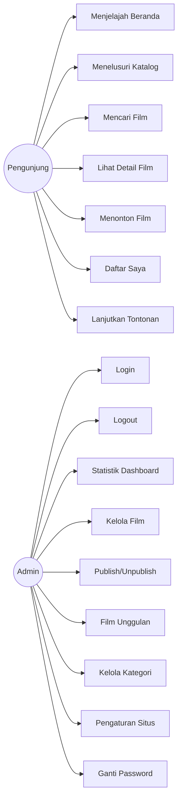

# Use Case — StreamFlix

Dokumen ini mendaftar use case untuk dua aktor utama: **Pengunjung (Visitor)** dan
**Admin**. Setiap use case memuat aktor, prakondisi (preconditions), alur utama (main flow),
dan alur alternatif (alternative flow).

## Daftar Aktor

| Aktor | Deskripsi |
|---|---|
| Pengunjung (Visitor) | Pengguna situs publik. **Tidak perlu login.** Daftar Saya & progres tontonan disimpan di `localStorage` browser. |
| Admin | Pengelola dashboard. Autentikasi berbasis sesi (cookie) + CSRF. |

## Ringkasan Use Case

| Kode | Nama | Aktor |
|---|---|---|
| UC-01 | Menjelajah Beranda | Pengunjung |
| UC-02 | Menelusuri Katalog Film | Pengunjung |
| UC-03 | Mencari Film | Pengunjung |
| UC-04 | Melihat Detail Film | Pengunjung |
| UC-05 | Menonton Film | Pengunjung |
| UC-06 | Menambah/Menghapus Daftar Saya | Pengunjung |
| UC-07 | Melanjutkan Tontonan | Pengunjung |
| UC-08 | Login Admin | Admin |
| UC-09 | Logout Admin | Admin |
| UC-10 | Melihat Statistik Dashboard | Admin |
| UC-11 | Mengelola Film (CRUD) | Admin |
| UC-12 | Publish/Unpublish Film | Admin |
| UC-13 | Menandai Film Unggulan | Admin |
| UC-14 | Mengelola Kategori | Admin |
| UC-15 | Mengubah Pengaturan Situs | Admin |
| UC-16 | Mengubah Password Admin | Admin |

---

## Pengunjung (Visitor)

### UC-01 — Menjelajah Beranda

- **Aktor**: Pengunjung
- **Prakondisi**: Backend dan database berjalan; minimal ada film `published`.
- **Alur utama**:
  1. Pengunjung membuka `/`.
  2. Frontend memanggil `GET /api/home`.
  3. Backend mengembalikan `{ hero, trending, newReleases, top10, genreRows }`.
  4. Halaman menampilkan hero carousel, baris Trending, Terbaru, Top 10 (dengan peringkat),
     dan baris per genre.
  5. Jika ada progres tontonan di `localStorage`, halaman menambahkan baris "Lanjutkan Menonton".
- **Alur alternatif**:
  - **A1** — Tidak ada film published: setiap bagian menampilkan `EmptyState`.
  - **A2** — Backend gagal: halaman menampilkan `ErrorState` dengan tombol "Coba Lagi".
  - **A3** — `hero` kosong: hero carousel tidak ditampilkan, baris lain tetap tampil.

### UC-02 — Menelusuri Katalog Film

- **Aktor**: Pengunjung
- **Prakondisi**: Minimal ada film `published`.
- **Alur utama**:
  1. Pengunjung membuka `/movies`.
  2. Frontend memanggil `GET /api/movies?page=1&limit=20&sort=newest`.
  3. Halaman menampilkan grid kartu poster dengan pagination.
  4. Pengunjung memilih urutan (`newest`, `oldest`, `title`, `popular`, `rating`) atau
     memfilter kategori.
  5. Frontend memanggil ulang dengan parameter terkait.
- **Alur alternatif**:
  - **A1** — Tidak ada hasil: `EmptyState` "Tidak ada film".
  - **A2** — `sort` tidak valid: backend memakai `newest` sebagai default (tidak error) atau
    mengembalikan `400 INVALID_SORT` bila diteruskan lewat validasi ketat; lihat `API.md`.
  - **A3** — Halaman melebihi total: daftar kosong; UI menampilkan pesan.

### UC-03 — Mencari Film

- **Aktor**: Pengunjung
- **Prakondisi**: Minimal ada film `published`.
- **Alur utama**:
  1. Pengunjung membuka `/search` dan mengetik kata kunci.
  2. Frontend memanggil `GET /api/movies?q=<kata kunci>`.
  3. Backend mencari pada `title` dan `synopsis` (indeks FULLTEXT).
  4. Halaman menampilkan hasil.
- **Alur alternatif**:
  - **A1** — Kata kunci kosong: tampilkan semua/prompt masukan.
  - **A2** — Tidak ada hasil: `EmptyState` "Tidak ada hasil untuk '...'".

### UC-04 — Melihat Detail Film

- **Aktor**: Pengunjung
- **Prakondisi**: Film berstatus `published`.
- **Alur utama**:
  1. Pengunjung membuka `/movies/:slug`.
  2. Frontend memanggil `GET /api/movies/:slug`.
  3. Backend mengembalikan detail film termasuk `videoUrl`.
  4. Halaman menampilkan poster/banner, sinopsis, tahun, durasi, rating, kategori, dan tombol
     Tonton / Tambah ke Daftar Saya.
- **Alur alternatif**:
  - **A1** — Slug tidak ditemukan (atau film masih `draft`): backend `404 NOT_FOUND`;
    halaman menampilkan `NotFoundPage`.
  - **A2** — Koneksi gagal: `ErrorState` + "Coba Lagi".

### UC-05 — Menonton Film

- **Aktor**: Pengunjung
- **Prakondisi**: Film `published` dan memiliki `videoUrl` MP4 yang valid.
- **Alur utama**:
  1. Pengunjung menekan Tonton → membuka `/watch/:slug`.
  2. Frontend memanggil `GET /api/movies/:slug` untuk memperoleh `videoUrl`.
  3. Video diputar dengan elemen `<video>`.
  4. Frontend memanggil `POST /api/movies/:slug/view` (tanpa body) untuk menambah `view_count`.
  5. Hook `useWatchProgress` menyimpan progres ke `localStorage` setiap ±5 detik.
- **Alur alternatif**:
  - **A1** — URL video tidak dapat diputar: pemutar menampilkan pesan error.
  - **A2** — `POST /view` dibatasi rate limit: respons `429 RATE_LIMITED` diabaikan (tidak
    menggagalkan pemutaran).
  - **A3** — Progres mencapai ≥ 95%: entri dihapus dari "Lanjutkan Menonton".

### UC-06 — Menambah/Menghapus Daftar Saya

- **Aktor**: Pengunjung
- **Prakondisi**: Tidak ada (tanpa login).
- **Alur utama**:
  1. Pada kartu/detail film, pengunjung menekan tombol "Daftar Saya" (toggle).
  2. Hook `useMyList` memperbarui array slug pada `localStorage` kunci `streamflix:my-list`.
  3. Perubahan tercermin pada ikon tombol dan halaman `/my-list`.
- **Alur alternatif**:
  - **A1** — Sudah maksimum 200 slug: slug terlama dibuang (batas `MY_LIST_MAX = 200`).
  - **A2** — `localStorage` tidak tersedia (mode privat): operasi gagal diam-diam (tidak error).
  - **A3** — Data localStorage rusak/tidak valid: Zod menolaknya dan daftar direset kosong.
  - **A4** — Membuka `/my-list` saat ada slug yang filmnya sudah tidak ada: entri tak valid dibuang.

### UC-07 — Melanjutkan Tontonan

- **Aktor**: Pengunjung
- **Prakondisi**: Pernah menonton film dan progres tersimpan.
- **Alur utama**:
  1. Pengunjung membuka Beranda atau `/my-list`.
  2. Aplikasi membaca `streamflix:watch-progress` dan menampilkan entri "Lanjutkan Menonton".
  3. Memilih entri membuka `/watch/:slug` pada posisi terakhir.
- **Alur alternatif**:
  - **A1** — Tidak ada progres: bagian tidak ditampilkan.
  - **A2** — Entri melewati umur/tidak valid: dibuang saat validasi Zod.
  - **A3** — Film dihapus/di-unpublish: entri dibuang dari daftar tampilan.

---

## Admin

> Semua use case admin (kecuali UC-08) memerlukan sesi aktif. Operasi yang mengubah data
> (POST/PUT/PATCH/DELETE) juga memerlukan header **`x-csrf-token`** yang valid.

### UC-08 — Login Admin

- **Aktor**: Admin
- **Prakondisi**: Akun admin aktif (`is_active = 1`) sudah dibuat (`npm run admin:create`).
- **Alur utama**:
  1. Admin membuka `/admin/login`.
  2. Admin mengirim email & password via `POST /api/auth/login` (rate-limited).
  3. Backend memverifikasi dengan bcrypt, meregenerasi session ID, dan menyimpan `adminId`.
  4. Backend mengembalikan `{ admin, csrfToken }`.
  5. Admin diarahkan ke `/admin/dashboard`.
- **Alur alternatif**:
  - **A1** — Kredensial salah: `401 INVALID_CREDENTIALS` (pesan generik).
  - **A2** — Akun nonaktif: `403 ACCOUNT_INACTIVE`.
  - **A3** — Terlalu banyak percobaan: `429 RATE_LIMITED` (8 percobaan / 15 menit).

### UC-09 — Logout Admin

- **Aktor**: Admin
- **Prakondisi**: Sesi aktif.
- **Alur utama**:
  1. Admin memilih Logout → `POST /api/auth/logout` dengan header CSRF.
  2. Backend menghancurkan sesi di server.
  3. Admin diarahkan ke `/admin/login`.
- **Alur alternatif**:
  - **A1** — Token CSRF tidak valid: `403 CSRF_INVALID` (frontend mengambil token baru lalu ulang).
  - **A2** — Sesi sudah kedaluwarsa: tetap dianggap berhasil (diarahkan ke login).

### UC-10 — Melihat Statistik Dashboard

- **Aktor**: Admin (sesi aktif)
- **Alur utama**:
  1. Admin membuka `/admin/dashboard`.
  2. Frontend memanggil `GET /api/admin/dashboard/stats`.
  3. Halaman menampilkan total film, published, draft, kategori, unggulan, total view,
     film baru diubah, dan film paling banyak ditonton.
- **Alur alternatif**:
  - **A1** — Sesi habis: `401 SESSION_EXPIRED` → diarahkan ke login.

### UC-11 — Mengelola Film (CRUD)

- **Aktor**: Admin (sesi aktif, CSRF)
- **Prakondisi**: Login berhasil.
- **Alur utama**:
  1. Admin membuka `/admin/movies` → `GET /api/admin/movies`.
  2. **Buat**: `/admin/movies/new` → `POST /api/admin/movies` (201).
  3. **Ubah**: `/admin/movies/:id/edit` → `GET` lalu `PUT /api/admin/movies/:id`.
  4. **Hapus**: `DELETE /api/admin/movies/:id` (204) — relasi kategori ikut terhapus (CASCADE).
- **Alur alternatif**:
  - **A1** — Validasi gagal: `422 VALIDATION_ERROR` dengan `details` per field.
  - **A2** — Slug bentrok: `409 SLUG_TAKEN`.
  - **A3** — URL video tidak valid: `422 INVALID_VIDEO_URL` atau `422 VIDEO_HOST_NOT_ALLOWED`.
  - **A4** — Data tidak ditemukan: `404 NOT_FOUND`.

### UC-12 — Publish/Unpublish Film

- **Aktor**: Admin (sesi aktif, CSRF)
- **Alur utama**:
  1. Admin menekan toggle status pada daftar/form.
  2. Frontend mengirim `PATCH /api/admin/movies/:id/status` `{ status: 'published' | 'draft' }`.
  3. Backend mengubah status (dan mengatur `published_at` bila baru terbit).
- **Alur alternatif**:
  - **A1** — `status` tidak valid: `422 VALIDATION_ERROR`.
  - **A2** — Film tidak ditemukan: `404 NOT_FOUND`.

### UC-13 — Menandai Film Unggulan

- **Aktor**: Admin (sesi aktif, CSRF)
- **Alur utama**:
  1. Pada form film, admin mengaktifkan sakelar "Unggulan" (`isFeatured = true`).
  2. Form disimpan (`POST`/`PUT /api/admin/movies`).
  3. Film muncul di bagian hero/unggulan Beranda bila `published`.
- **Alur alternatif**:
  - **A1** — Menandai draft sebagai unggulan: tersimpan, tetapi tidak tampil di publik sampai published.

### UC-14 — Mengelola Kategori

- **Aktor**: Admin (sesi aktif, CSRF)
- **Alur utama**:
  1. Admin membuka `/admin/categories` → `GET /api/admin/categories`.
  2. **Buat**: `POST /api/admin/categories` `{ name, slug? }` (201).
  3. **Ubah**: `PUT /api/admin/categories/:id`.
  4. **Hapus**: `DELETE /api/admin/categories/:id` (204).
- **Alur alternatif**:
  - **A1** — Hapus kategori yang masih dipakai film: `409 CATEGORY_IN_USE`
    (FK `ON DELETE RESTRICT`).
  - **A2** — Nama/slug duplikat: `409 CONFLICT` / `409 SLUG_TAKEN`.
  - **A3** — Validasi gagal: `422 VALIDATION_ERROR`.

### UC-15 — Mengubah Pengaturan Situs

- **Aktor**: Admin (sesi aktif, CSRF)
- **Alur utama**:
  1. Admin membuka `/admin/settings` → `GET /api/admin/settings`.
  2. Admin mengubah nama situs, tagline, SEO, social, `hero_slide_limit`.
  3. Simpan → `PUT /api/admin/settings`.
- **Alur alternatif**:
  - **A1** — `hero_slide_limit` bukan angka valid: `422 VALIDATION_ERROR`.
  - **A2** — Sesi habis: `401 SESSION_EXPIRED`.

### UC-16 — Mengubah Password Admin

- **Aktor**: Admin (sesi aktif, CSRF)
- **Alur utama**:
  1. Admin membuka pengaturan akun.
  2. Mengirim `PUT /api/admin/account/password` `{ currentPassword, newPassword }`.
  3. Backend memverifikasi `currentPassword`, lalu menyimpan hash `newPassword`.
- **Alur alternatif**:
  - **A1** — `currentPassword` salah: `401 INVALID_CREDENTIALS`.
  - **A2** — `newPassword` < 12 karakter: `422 VALIDATION_ERROR`.
  - **A3** — Password baru sama dengan lama: `422 VALIDATION_ERROR`.

---

## Diagram Use Case (Ringkas)

Dokumen terkait: [`FLOWCHART.md`](./FLOWCHART.md) · [`API.md`](./API.md).
